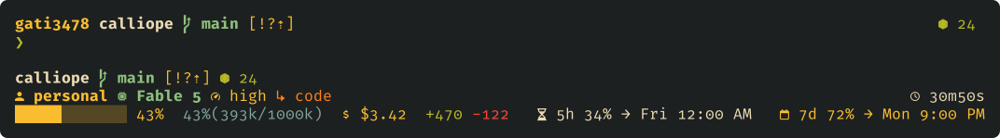

# cship · Gruvbox Dark Hard

A three-line statusline for [Claude Code](https://claude.com/claude-code),
rendered by [cship](https://github.com/stephenleo/cship): where you are,
whose session it is and which model, how much of the context and the budget
is gone, and when the usage windows reset. Take it alone: the installer fetches
one shared helper from this repository the way it fetches the configs, and
nothing it installs points back here.



Drawn from this directory's `cship.toml` and `starship.toml`, the author's
live configuration verbatim, in the palette the
[kitty piece](../terminal/kitty/README.md) sets. The `preferences.toml` a
comment names ships with the whole setup, in `taste/`, not with this
directory.

## What you need

**Required**

- **cship 1.8.2 or newer.** Either of its own routes:
  `curl -fsSL https://cship.dev/install.sh | bash` (the binary, a starter
  config, and the `settings.json` wiring) or `cargo install cship` (the
  binary only). The floor is where per-window usage tokens and `CSHIP_ACCOUNT`
  arrived.
- **A Nerd Font in the terminal.** Built against FiraCode Nerd Font Mono
  (`brew install --cask font-fira-code-nerd-font`). Without one every icon is
  a blank cell, so nothing looks broken; the icons are simply not there.
- **A dark terminal.** The palette is Gruvbox Dark Hard as literal hexes,
  chosen against its `#1d2021` ground. There is no light variant.

**Optional**

- **starship**, for line 1. Without it line 1 is absent and lines 2 and 3
  render as normal. With it, line 1 renders under **your** starship config.
  `starship.toml` here is the one the picture was drawn with, and taking it
  replaces your shell prompt, because starship reads one file for both: two
  lines, context above, a bare `❯` below, the toolchain at the right margin.

## Install

First the plan: every file the run would touch, and nothing written. It
prints without cship too, or with one below the floor, beside the two ways
to install it.

```sh
curl -fsSL https://raw.githubusercontent.com/gati3478/preen/v2.2.7/prompt/install.sh | bash -s -- --dry-run
```

Then the install, one line, no clone:

```sh
curl -fsSL https://raw.githubusercontent.com/gati3478/preen/v2.2.7/prompt/install.sh | bash
```

Or from a clone, `./prompt/install.sh`; `--help` is its manual. It

1. finds cship — on `PATH`, or at `~/.local/bin/cship` or `~/.cargo/bin/cship`
   where its two installers put it — and refuses when there is none or it is
   below 1.8.2; a dry run then skips the questions and prints the plan;
2. asks whether to take `starship.toml` too, and what to call your account
   (next section);
3. copies `cship.toml` to `~/.config/cship.toml`, a plain file: a different
   one there, or a symlink, is first moved aside as
   `cship.toml.unpreened.<timestamp>`, and an earlier copy this setup shipped
   is replaced without a backup. A link into a clone of the whole setup is
   left as it is (below);
4. wires `statusLine` in `~/.claude/settings.json` (or under
   `CLAUDE_CONFIG_DIR`, if you set it): added when absent; unchanged when it
   runs this already; else taken over, after a backup, when it runs a lone
   cship, bare as cship's installer leaves it or with the label this
   installer puts before it; left alone, and said so, when it runs anything
   else. Every other key is kept; the file comes back re-serialised with
   two-space indentation. A symlinked one, or `~/.claude`, is written
   through, as Claude Code does, and the plan names the file the entry lands
   in. When the entry is not written — no `~/.claude`, no working python3
   (on a Mac, `xcode-select --install`), another tool's entry — the exact
   entry to paste is printed.

Every refusal comes before the first write, so a stopped run has changed
nothing, and a dry run makes each one but cship's: among them a run as root,
a `settings.json` that is not a JSON object, and a symlinked `~/.config`,
which would put the copies wherever it points.

Under a pipe the questions still reach you through the terminal. Each flag
answers one; with both answered nothing is asked, and with no terminal the
defaults are taken — `starship.toml` left alone, the account module hidden:

```sh
curl -fsSL https://raw.githubusercontent.com/gati3478/preen/v2.2.7/prompt/install.sh | bash -s -- --with-starship --account-label personal
./prompt/install.sh --no-starship --no-account
```

By hand it is the same steps: copy the file, optionally the second, and add
to `~/.claude/settings.json`

```json
"statusLine": { "type": "command", "command": "/absolute/path/to/cship", "refreshInterval": 60 }
```

`refreshInterval` re-renders on a timer, so the clock and the windows keep
moving while a session idles. cship's own installer writes the entry without
it, and re-run to upgrade cship it writes that bare entry back, label and
timer gone: run this installer again afterwards, and it takes the entry over.

Took the whole repository through `bin/bootstrap`? `cship.toml` and
`starship.toml` are links into your clone, but `settings.json` is not wired.
Run this installer afterwards: it leaves the links as they are, asks nothing
about `starship.toml`, and wires the entry. Hiding the account module takes a
line in the setup's own `cship.toml`, so blank, or no answer, leaves the
module as that file has it; name the account with `--account-label` instead.

## The account module, and your email

`[cship.account]` on line 2 names whose session this is. Left to itself,
cship fetches the organisation name behind your credential — and on a
personal rather than a team account that name **is your email address**,
which then sits in every screenshot. The installer's question is the switch:

- **A label** goes into the statusLine command as
  `CSHIP_ACCOUNT='{"organization_name":"…"}'`. cship renders it and fetches
  nothing. It rides the entry the installer writes, so where another command
  runs there the label is not applied, and the summary says so.
- **Blank** puts `disabled = true` under `[cship.account]` in your copy and
  drops the module's slot from line 2, so no blank cell is left where it
  stood. Nothing else changes.

The shipped file carries neither: it is the author's live config, fed by a
launcher that sets the variable per session.

## What's in the layout

- **Line 1** — Starship passthrough: directory, git branch, commit on a
  detached HEAD, in-progress git operation, git status, runtime versions
  (Python, Java, Kotlin, Gradle, Rust, Node). Each module's look comes from
  `starship.toml`; which modules appear is `cship.toml`'s own list.
- **Line 2** — account label, model (per-family colour), reasoning effort
  (per-level colour), active agent; session duration right-aligned via
  `$fill`.
- **Line 3** — 12-cell context bar, absolute token usage `43%(393k/1000k)`,
  session cost, lines added/removed; 5-hour and 7-day usage windows
  right-aligned, each with its absolute local reset time
  (`72% → Tue 1:00 AM`).

Warn/critical thresholds: context 40/70 %, cost $2/$5, usage windows
70/90 % — gold at warn, bold red at critical, each a `warn_threshold` /
`critical_threshold` pair in the file.

## Why it is shaped this way

cship renders what Claude Code pipes it on every refresh — rate limits, cost,
context, model — and can fetch more through the OAuth API: per-model burn,
extra usage, account info. That fetch reads the default keychain credential
whatever `CLAUDE_CONFIG_DIR` says
([cship#194](https://github.com/stephenleo/cship/issues/194)), so with several
accounts all it feeds is the default account's. This layout takes nothing
from it but the 5h/7d figures for the seconds before a session's first API
response brings `rate_limits`, and the account module's name where the
module is left to itself (above). A per-model line is left out for the same
reason; with one account it is safe to add (`$cship.usage_limits.per_model`
as a fourth line, plus the `opus_format` / `sonnet_format` / `cowork_format`
/ `oauth_apps_format` / `extra_usage_format` entries). A failed fetch costs
one render a 2 s stall, then a 30 s cooldown, never a broken row.

**The metrics line's content alone runs to about 100 cells**, so a window
narrower than that plus the right margin overflows it however `width` is
set.

## Tuning

- **Terminal width** — `width` is read only where cship finds neither a
  terminal nor `$COLUMNS`: Windows, the web and desktop apps. There it should
  be your terminal's column count; elsewhere a resize never misaligns
  anything.
- **Right margin** — `width_offset` ships at 4, the columns Claude Code
  keeps around the statusline. A trailing `…` on the right after a Claude
  Code update means it needs re-measuring.
- **Several accounts**, switched with `CLAUDE_CONFIG_DIR` — export
  `CSHIP_ACCOUNT` from whatever picks the account, compact JSON such as
  `{"organization_name":"work"}`; `{label}` falls back to `{organization}`,
  so no label map is needed. The installer wires the `settings.json` under
  `CLAUDE_CONFIG_DIR`, so accounts share the entry only if they share that
  file.
- **Seeing what cship sees** — `cship explain` tabulates every module's
  value beside the config block that styles it, for when a module shows
  nothing.

## Glyphs

All icons are Nerd Font glyphs: microchip (model), speedometer (effort),
account (account label), dollar (cost), clock (duration),
hourglass (5h), calendar (7d).

> [!WARNING]
> **Some tooling silently flattens these glyphs into spaces.**
> Some editors and formatters replace private-use-area codepoints with spaces
> on rewrite, and a space fills the same cell, so the loss is invisible. If
> you edit `cship.toml`, check the icons are still there afterwards.

## Palette — Gruvbox Dark Hard

| Role           | Hex       |
| -------------- | --------- |
| background     | `#1d2021` |
| aqua           | `#8ec07c` |
| green          | `#b8bb26` |
| gold (warn)    | `#fabd2f` |
| red (critical) | `#fb4934` |
| foreground     | `#ebdbb2` |
| blue           | `#83a598` |
| purple         | `#d3869b` |
| orange         | `#fe8019` |
| bg1 (inactive) | `#3c3836` |
| gray (dim ink) | `#928374` |

Model families: Fable `#8ec07c` · Opus `#83a598` · Sonnet `#d3869b` ·
Haiku `#b8bb26`. The table is the whole theme; `background`, `bg1` and
`gray` are the terminal's own, and no module here uses them.

## Updating

Run the install line from this page again: it names the newest release.
From a clone, `git pull`, then `./prompt/install.sh`. An earlier copy this
setup shipped comes back `updated`, with no backup — `starship.toml` only
when you take it again, with `--with-starship` or a yes. One you edited is
backed up beside itself first, and so is a `cship.toml` with the account
hidden, which no release shipped. Neither file has an overlay, so carry an
edit of yours over from the backup.

## Leaving

1. Remove the `statusLine` entry from the `settings.json` the run wired, or
   run `cship uninstall`, which removes the entry, the binary and its
   caches. Delete any backup of `settings.json` beside it: it predates what
   Claude Code wrote there since.
2. Remove `~/.config/cship.toml`, and `~/.config/starship.toml` if you took
   it, unless you had it before the first run. `cship uninstall` leaves
   `cship.toml` where it is.
3. Where one you had before was replaced, its earliest backup beside it,
   `<file>.unpreened.<timestamp>`, is what was there: move it back. A later
   backup is what a later run replaced.

## License

MIT
